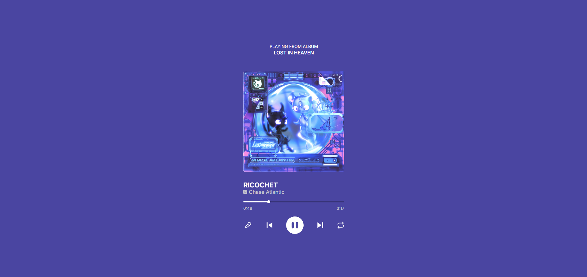
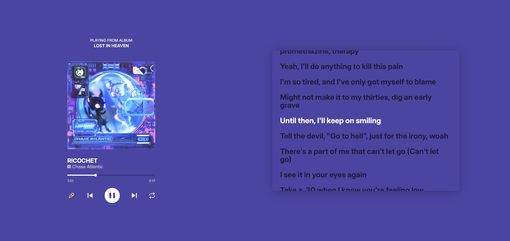
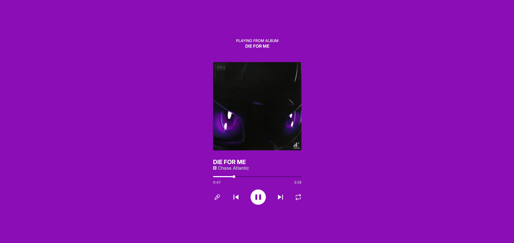

# Music Player

A music player built with React. The whole player takes its colors from the album art.



## Features

- **Play, pause, or skip** to the next or previous song
- **Seek** to any point with the time slider
- **Lyrics mode:** open the lyrics next to the player, with the current line highlighted
- **Colors that follow the album art:** the background changes to match whatever album is playing

| Lyrics mode | Colors change with each album |
| :---: | :---: |
|  |  |

## Tech stack

- **Frontend:** React, Vite
- **Desktop app:** Electron
- **API:** Node.js, Express, PostgreSQL (`music-api/`)
- **Also uses:** Axios, extract-colors

## Run it locally

You'll need [Node.js](https://nodejs.org) 18 or newer.

The audio, lyrics (.lrc), and cover files aren't included in this repo. To run it, add your own files (make new folders) to public/audio, public/lrc, and public/images, then add a row for each song to the songs table (see schema.sql).

```bash
git clone https://github.com/mirelalexy/music-player.git
cd music-player
npm install
npm run dev
```

The app runs at `http://localhost:5173`.

### Desktop version (Electron)

With the dev server running, open a second terminal and run:

```bash
npm run electron
```

### API

The player loads its songs from a small Express API (`music-api/`) backed by PostgreSQL. You'll need [PostgreSQL](https://www.postgresql.org/download/) installed and running.

**1. Create the database and the `songs` table** (from the project root):

```bash
createdb music-player
psql -d music-player -f schema.sql
```

`schema.sql` also inserts an example row. Add one row per song, with paths relative to `public/` (e.g. `/audio/my-song.mp3`).

**2. Install the API's dependencies:**

```bash
cd music-api
npm install
```

**3. Create a `music-api/.env` file with your database settings:**

```
DB_USER=your_user
DB_PASSWORD=your_password
DB_HOST=localhost
DB_PORT=5432
DB_DATABASE=music-player
```

**4. Start the API:**

```bash
node index.js
```

Keep it running while you use the player (the app fetches its song list from it).

## About this project

My second app in React. I built it to practice working with audio, state, an API, and Electron, and to make a player I'd actually enjoy looking at. I synced the lyrics myself with an LRC editor when adding songs in the database. That was a lot of manual work I'd do much faster today. Still, this project is what got me excited about building web apps and desktop ones with Electron.
